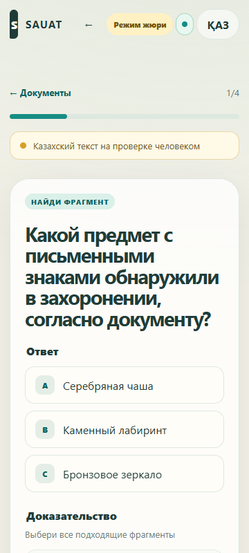

# SAUAT — Оқы да дәлелде

Ученик не угадывает ответ, а доказывает его фрагментом текста.

## Что это

SAUAT — двуязычное offline-first PWA для практики функциональной грамотности через короткие истории и задания на ответ, вывод и доказательство.

## Для кого

Ученики 7–9 классов, особенно сельские школы со слабым интернетом; учитель, которому нужен экспорт ученических событий и просмотр типов ошибок.

## Главный результат

Стартовый набор demo — ≈123,4 КБ gzip; в нём 7 историй: 5 practice и 2 diagnostic. После первой загрузки публичная версия работает офлайн. Пилот не проводился, эффект на грамотность не доказан.

[Прототип](https://tushs328-cmd.github.io/Sauat/) · [Режим жюри ?jury=1](https://tushs328-cmd.github.io/Sauat/?jury=1) · [Видео](docs/video/SAUAT_pitch.mp4) · [Слайды PDF](docs/slides/export/slides.pdf)




[Дорожная карта](docs/sauat/ROADMAP.md) · [Приватность](docs/sauat/PRIVACY_AND_DATA_FLOW.md) · [Как добавить историю](docs/sauat/AUTHORING_GUIDE.md)

## Проверить за 2 минуты

Сначала без установки: откройте [прототип](https://tushs328-cmd.github.io/Sauat/), затем [режим `?jury=1`](https://tushs328-cmd.github.io/Sauat/?jury=1). В режиме жюри открыты 7 историй.

Локально в чистой копии:

```bash
git clone --depth 1 https://github.com/tushs328-cmd/Sauat.git
cd Sauat
npm ci
npm run build:demo
python -m http.server 4173 --directory dist
```

Откройте `http://127.0.0.1:4173/?jury=1`. Команда `python -m http.server 4173 --directory dist` проверена в чистой копии на Windows; это стандартный сервер Python 3 для Windows и Linux. `file://` не используйте: Service Worker и относительные запросы требуют HTTP.

## Как это работает

История → отдельный ответ и отдельное доказательство → подсказка наставника трёх уровней → итоги «След доказательств».

Из ученического кабинета результат экспортируется в JSON, затем учитель импортирует файл и видит навыки и типы ошибок. Диагностика разделена на entry и exit.

## Что проверено

| Что | Результат | Как воспроизвести |
|---|---|---|
| Тесты | 72/72, exit 0 | `npm test` |
| Валидатор контента | exit 0; 2 эвристических warning о самом длинном правильном варианте | `npm run validate` |
| Demo-сборка | 7 историй: 5 practice + 2 diagnostic; exit 0 | `npm run build:demo` |
| Static smoke | PASS; subpath, assets, Service Worker, offline rules и export guards; exit 0 | `node scripts/static-smoke.mjs --include-draft` |
| Размер | стартовый набор 123,4 КБ gzip; всего 126,5 КБ gzip; exit 0 | `npm run size` |
| Живой прогон первых заданий | 56/56: 7 историй × 2 языка × 2 ширины × 2 темы | [отчёт FINAL_ACCEPTANCE_R2](docs/sauat/reports/FINAL_ACCEPTANCE_R2.md); команда в отчёте не указана |
| Rules против зафиксированного эталона | 12/12 сценариев; 12/12 допустимых `hintId`; 12/12 допустимых `nextTaskId` | `INCLUDE_DRAFT=1 node eval/persona/run-compare.js` |

Сверка 12/12 относится к синтетическим профилям и встроенным rules; живой ответ Ollama в этом запуске не измерялся.

## Роль ИИ — честно

В публичной версии работают встроенные правила. Локальная Ollama с `qwen2.5:1.5b` — экспериментальный выбор стратегии подсказки внутри allowlist. Живая проверка на финальной версии не выполнена; преимущество над правилами не установлено.

## Честные пределы

- Все 7 историй имеют статус `draft`.
- Казахский текст не проверен носителем.
- Педагогический пилот не проводился; влияние на грамотность не измерялось.
- Safari и физический телефон не проверены; проверены Chromium на ширинах 360 и 1280 px.
- Docker smoke и живой контракт Ollama не выполнены: Docker daemon недоступен.
- Статическая версия хранит прогресс и события локально; это не серверная синхронизация между школами.

## Стек

Из `package.json`: Node.js `>=18`, Express 4, Ajv 8, Multer 2, pdf-parse 1. Клиент — HTML, CSS и JavaScript PWA с JSON-контентом, Service Worker и локальным хранилищем.

## Структура репозитория

`public/` — статический клиент и ассеты; `src/` — сервер, валидатор, контент и наставник; `content/` — JSON-истории; `scripts/` — сборка, smoke и размер; `eval/` — проверки наставника; `test/` — тесты.

`docs/sauat/` — документы проекта; `docs/video/` — видео; `docs/slides/` — слайды. Старое содержимое README сохранено в [LEGACY_README.md](docs/sauat/LEGACY_README.md) с пометкой «Legacy / серверный режим».

## Документы

- [Release Candidate](docs/sauat/RELEASE_CANDIDATE.md) и [финальная приёмка R2](docs/sauat/reports/FINAL_ACCEPTANCE_R2.md)
- [Дорожная карта](docs/sauat/ROADMAP.md), [приватность и поток данных](docs/sauat/PRIVACY_AND_DATA_FLOW.md)
- [Как добавить историю](docs/sauat/AUTHORING_GUIDE.md), [legacy / серверный режим](docs/sauat/LEGACY_README.md)

## Использованные ИИ-инструменты

Codex, ChatGPT, Claude — разработка и проверка; OpenAI ImageGen — иллюстрация; ElevenLabs — озвучка видео; Ollama — опциональный локальный адаптер; Playwright — тестирование.

Использование ИИ-инструментов разрешено п. 6.3 положения хакатона. Визуальная методика unslop: Дамир Соколовский, CC BY 4.0.

## Команда

MEms — автор проекта.
