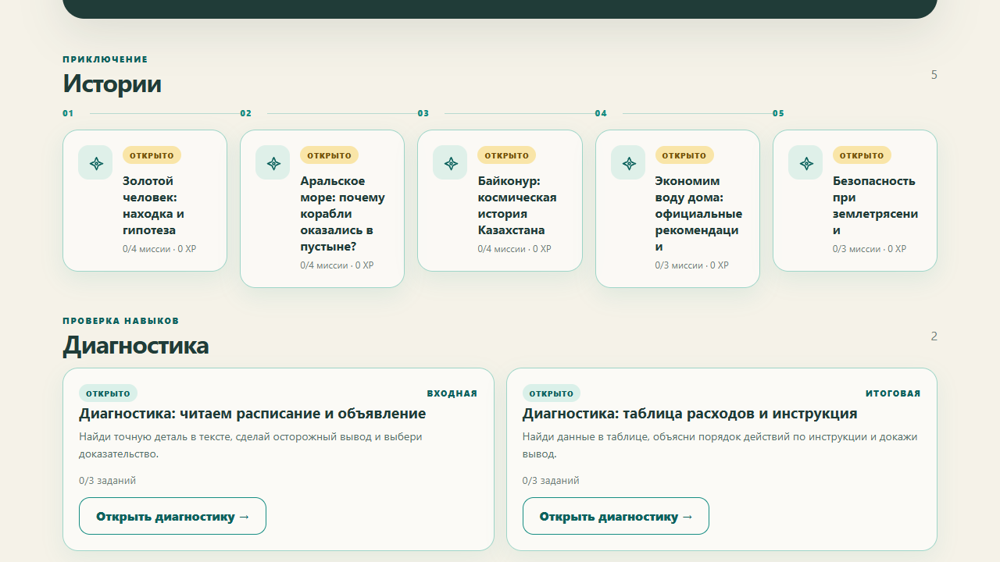

# SAUAT — Оқы да дәлелде

**Читай. Находи доказательство. Делай вывод.**

[Прототип](https://tushs328-cmd.github.io/Sauat/) · [Режим жюри](https://tushs328-cmd.github.io/Sauat/?jury=1) · [Видео YouTube](https://youtu.be/a-U3QH7f7eM) · [Слайды](docs/slides/export/slides.pdf)

## Что это

SAUAT — двуязычный offline-first PWA для тренировки функциональной грамотности у учеников 7–9 классов.<br>
Ученик читает короткую историю, выбирает ответ и отдельно отмечает фрагмент-доказательство.<br>
Подсказка указывает на тип ошибки, а учитель видит прогресс и экспорт событий без отправки данных во внешний ИИ-сервис.

## Для кого

Для учеников 7–9 классов, которым нужно учиться отличать факт от вывода и подтверждать ответ текстом; для учителей и сельских школ, где важны простой сценарий и работа после первоначальной загрузки даже при нестабильном интернете.

## Главный результат

**124 КБ gzip · 7 историй · офлайн после первой загрузки**

Демо включает 5 practice-историй и 2 диагностические истории. Все записи имеют статус `draft`: это проверяемый конкурсный прототип, а не результат педагогического пилота.




## Требования положения → выполнено → где проверить

| Требование | Выполнено | Где проверить |
|---|---|---|
| п. 6.1 — описание | Краткое описание, сценарий и ограничения опубликованы | Этот README; [описание для формы](docs/sauat/SUBMISSION_FORM.md) |
| п. 6.1 — прототип | Публичный прототип и отдельный режим жюри | [Прототип](https://tushs328-cmd.github.io/Sauat/); [режим `?jury=1`](https://tushs328-cmd.github.io/Sauat/?jury=1) |
| п. 6.1 — код | Исходники клиента, сервера, контента и скриптов находятся в репозитории | [`public/`](public/), [`src/`](src/), [`content/`](content/), [`scripts/`](scripts/) |
| п. 6.1 — презентация до 10 слайдов | PDF-презентация собрана; в файле 10 слайдов | [`docs/slides/export/slides.pdf`](docs/slides/export/slides.pdf) |
| п. 6.1 — видео до 3 минут | Питч-файл есть в репозитории и укладывается в лимит; видео на YouTube: https://youtu.be/a-U3QH7f7eM | [`docs/video/SAUAT_pitch.mp4`](docs/video/SAUAT_pitch.mp4); [метаданные загрузки](docs/video/YOUTUBE_META.md) |
| п. 6.3 — инструменты и ИИ | Использованные инструменты и границы ИИ раскрыты явно | Разделы [«Роль ИИ — честно»](#роль-ии-честно) и [«Использованные инструменты»](#использованные-инструменты); [AI card](docs/sauat/AI_CARD_RU.md) |
| п. 8.2 — понимание проблемы | Показана проблема доказательного чтения в слабой сети | [Описание и проблема](docs/sauat/SUBMISSION_FORM.md) |
| п. 8.2 — решение | Истории, доказательства, подсказки, диагностика и учительский экспорт реализованы в демо | [`public/`](public/), [`content/`](content/), [описание решения](docs/sauat/SUBMISSION_FORM.md) |
| п. 8.2 — техническая реализация | Статическая PWA-сборка, Service Worker, локальное хранилище, валидатор и rules-наставник | [`package.json`](package.json), [`src/`](src/), [`scripts/`](scripts/) |
| п. 8.2 — польза | Ученик видит связь ответа с источником и ошибкой; учитель получает прозрачный учебный след | [Раздел «Польза и масштаб»](docs/sauat/SUBMISSION_FORM.md) |
| п. 8.2 — презентация | Проблема, решение, техреализация и ограничения собраны в короткий pitch deck | [`docs/slides/export/slides.pdf`](docs/slides/export/slides.pdf) |

## Проверить за 2 минуты

1. Откройте [прототип](https://tushs328-cmd.github.io/Sauat/?jury=1) — режим жюри сразу показывает все 7 историй.
2. Для локального запуска из корня `Saulat_Sauat` выполните:

```bash
npm ci
npm run build:demo
python -m http.server 4173 --directory dist
```

3. Откройте `http://127.0.0.1:4173/?jury=1`.

Первый запуск требует сети для загрузки и установки Service Worker. После кэширования основной сценарий доступен офлайн.

## Что проверено

| Число | Команда / подтверждение |
|---:|---|
| `72/72` | `npm test` — 72 теста прошли, 0 ошибок |
| `0` | `npm run validate` — контент валиден; эвристические предупреждения о длине вариантов не скрыты |
| `7` | `npm run build:demo` — demo-сборка содержит 7 draft-историй |
| `5 + 2` | `node scripts/static-smoke.mjs --include-draft` — 5 practice и 2 diagnostic, assets, Service Worker, offline rules и export guards |
| `124 КБ gzip` | Зафиксировано в clean-copy jury smoke: [`FINAL_JURY_PASS.md`](docs/sauat/reports/FINAL_JURY_PASS.md) |

## Роль ИИ — честно

В публичной статической сборке подсказки выдаёт встроенный rules-наставник. Ollama подключается только локально в серверном режиме и выбирает стратегию внутри allowlist; живое преимущество модели над правилами не заявляется. Демо-события синтетические, пилот с учениками не проводился, образовательный эффект не измерялся.

## Границы прототипа

- Все 7 историй остаются `draft`; казахский текст требует проверки носителем.
- Первый визит требует сети; офлайн относится к уже загруженной и закэшированной сборке.
- Данные статической версии хранятся на устройстве; это не серверная синхронизация между школами.
- Safari, физический телефон и production-нагрузка отдельно не подтверждены.
- Видео: https://youtu.be/a-U3QH7f7eM (доступ по ссылке); локальный файл питча — в репозитории.

## Использованные инструменты

Codex, ChatGPT, Claude, ElevenLabs, ImageGen, Ollama локально, Express, Ajv, Playwright.

ИИ использовался для разработки, подготовки черновиков, архитектурного и QA-ревью, иллюстрации и озвучки. Финальная статическая версия сохраняет проверяемый rules-fallback и не выдаёт локальный эксперимент с Ollama за обязательную часть публичного прототипа.
